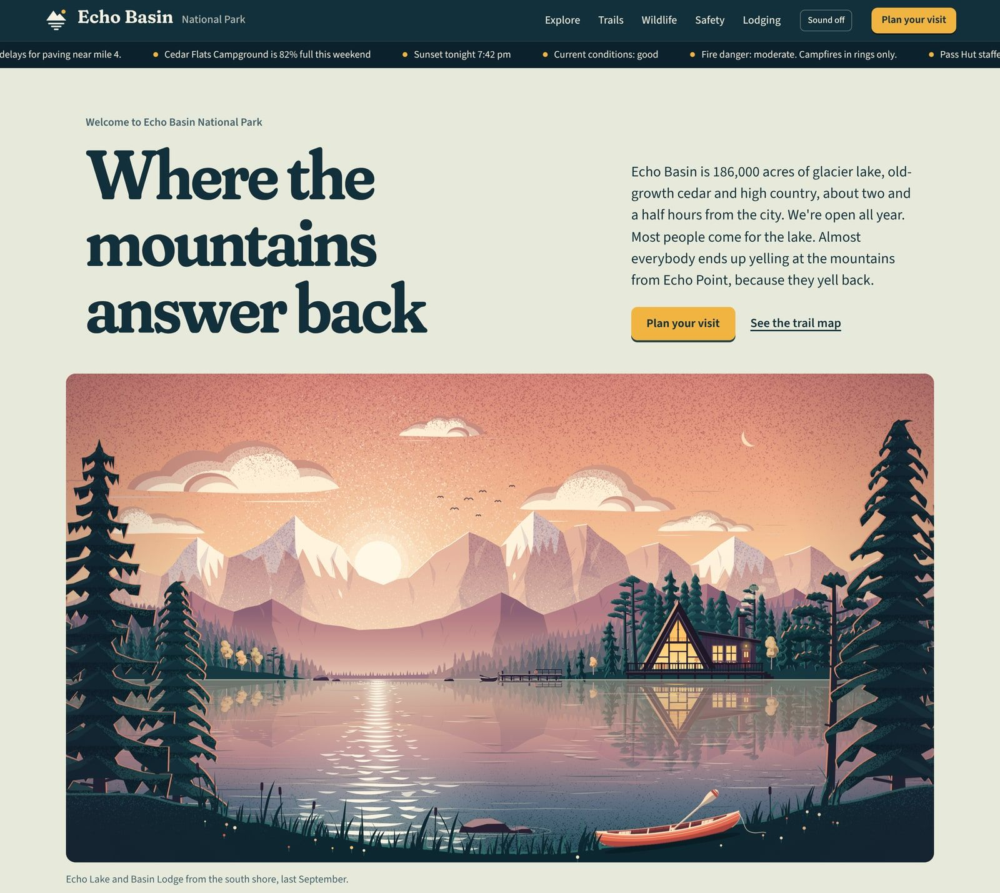

# Echo Basin

This is the visitor website for Echo Basin National Park. I built it for the park authority over the summer and I've looked after it since.

None of the text is mine. Staff send in the trail conditions, alerts and closures, and the site posts whatever comes in. Since about the middle of September the updates have been getting strange, and I can't get anyone at the park office to pick up the phone. I've left everything exactly as it was sent. Read around the site for a while and you'll see what I mean. A few of the people on the staff page stop being mentioned.

Updates are still coming in from somewhere, so this will keep changing. If you've been up to the basin lately, I'd like to hear from you.

## Looking at it

Open `dist/index.html` in a browser. It's a folder of pages now, not the one file it used to be, but it still works straight from disk. To see it the way it runs on a server:

    node serve.mjs

and open the address it prints.

## Working on it

    node build.mjs

That rebuilds `dist/`. There's nothing to install. It's been built with Node 22 and later.

- `src/content.mjs` and the files in `src/content/` are all the text, with every version of each line in the order it came in
- `src/pages/` has one file for each page, and `src/pages.mjs` lists them
- `src/scene-*.mjs` draw the pictures. They're SVG made by code, so there are no image files
- `src/site.css` and `src/runtime.js` handle the layout and what the pages do as you read
- `echo-check.mjs` checks that the echo diagram still agrees with the park map, and `profile-check.mjs` does the same for the trail profile
- `picture-check.mjs` checks that none of the pictures has changed since they were last recorded in `pictures.lock.json`
- `shots.mjs` photographs every page at every stage into `shots/`, and `preview.mjs` does one picture by itself. They need Chrome on the machine and nothing else
- `walk.mjs` reads through the site the way a visitor would and reports what changed and when

The fonts are Fraunces and Source Sans 3 (SIL Open Font License) and Special Elite (Apache 2.0).
